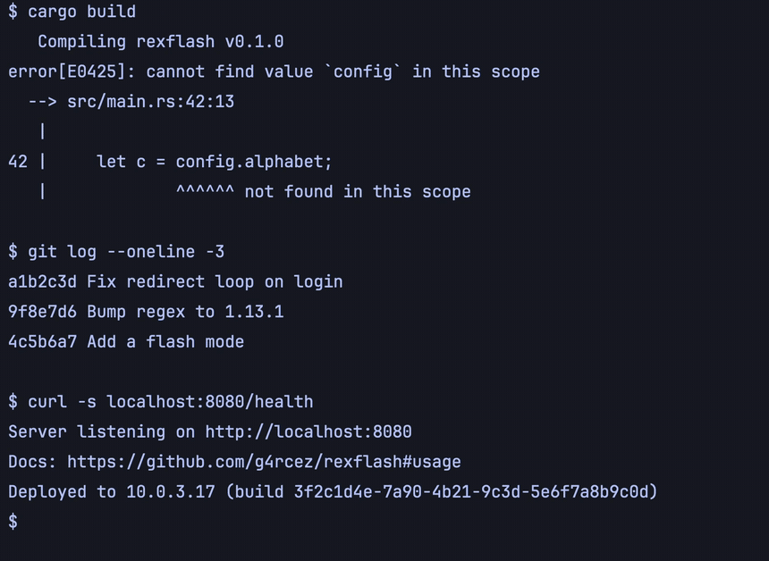

# tyrannosaur

[](https://github.com/g4rcez/tyrannosaur/actions/workflows/ci.yml)
[](LICENSE)

One [Rex](https://www.superlogical.com/rex/docs) plugin that holds many. You load it once, and the config has one
table per plugin. A plugin that is not in the table is disabled.

| Plugin   | What it does |
| -------- | ------------ |
| `flash`  | Labels URLs, paths, hashes and more in a pane (`hints`), or whatever you type (`flash`). Press a label to copy, paste or open. |
| `panes`  | Shows a big number over each pane. Press a digit to focus that pane, like tmux `display-panes`. |
| `scroll` | Scroll mode. `K`/`J` scroll a page, also in full-screen programs such as `claude`. |

```lua
dofile("/path/to/tyrannosaur/tyrannosaur.lua") {
    panes = { keys = { "alt+q" } },
    flash = {
        hints = { "cmd+y", "alt+y" },
        flash = { "alt+/" },
    },
    scroll = { keys = { "ctrl+p>s" } },
}
```

- A plugin value is a table of options, or `true` for the defaults. `false` or no entry disables it.
- A name with no folder in `plugins/` is an error (`unknown plugin 'pane'`), so a typo does not pass in silence.
- A key option takes one key (`"alt+q"`) or a list. A `>` makes a chord: `ctrl+p>q` is Ctrl-P, then `q`.
- Without keys, a plugin still defines its actions. Bind them yourself: `rex.bind("ctrl+p>q", "panes_select")`.

Run `rex actions` and `rex keymap` to see what is defined and bound.

## Quick start

1. Install ([below](#install)).
2. Add this to your Rex `init.lua` (`~/.config/rex/init.lua`):

   ```lua
   dofile(os.getenv("HOME") .. "/src/tyrannosaur/tyrannosaur.lua") {
       panes = { keys = "alt+q" },
       flash = { hints = "alt+y", flash = "alt+/" },
   }
   ```

3. Reload Rex. Press `alt+y` in a pane that shows a URL or a path, then press the label next to it.

## Requirements

- macOS and [Rex](https://www.superlogical.com/rex/docs)
- `flash` uses `pbcopy` and `open`. `panes` needs `bash` and `jq`.

## Install

### From source

```sh
git clone https://github.com/g4rcez/tyrannosaur ~/src/tyrannosaur
cd ~/src/tyrannosaur
cargo build --release --manifest-path plugins/flash/Cargo.toml   # only for the flash plugin
```

Then use the path of `tyrannosaur.lua` in the `dofile` call. `flash` finds `plugins/flash/target/release/flash`
by itself. Run the build again after you change the Rust code.

### From a release

Download the archive for your Mac from the [releases page](https://github.com/g4rcez/tyrannosaur/releases).
It holds `tyrannosaur.lua`, `lib.lua` and `plugins/`, with the `flash` binary in `plugins/flash/bin/`.

### With an AI agent

If your agent uses the Rex skill (`rex skill setup`), ask it to follow [AI_INSTRUCTIONS.md](AI_INSTRUCTIONS.md).

## `flash`



Port of the ideas in [tmux-fingers](https://github.com/Morantron/tmux-fingers) (hints) and
[flash.nvim](https://github.com/folke/flash.nvim) (search labels) to Rex. Actions: `flash_hint` and `flash_search`.

- **Hints** label what looks like something you want to grab: URLs, `file:line` references, paths, hashes, IPs,
  UUIDs, emails, versions and more.
- **Flash** labels whatever you type. Type `loc`, then press the label next to the match.
- **Three ways to pick.** Lowercase label: copy. Uppercase (Shift): paste into the pane. Ctrl: open.
  All three are configurable, and a pick is always copied first.
- **Scrollback.** The overlay captures 2000 rows of history by default. Page Up and Page Down scroll it.
- **Safe by design.** Text from the screen never reaches a shell string. It goes to a command as stdin
  or as one argument.

### Use

Press the key of `hints` or `flash`, then a label:

| Key               | What it does                                        |
| ----------------- | --------------------------------------------------- |
| a label           | Copy the match                                      |
| Shift + a label   | Copy it and paste it into the pane                  |
| Ctrl + a label    | Copy it and open it                                 |
| `q`, Esc, Ctrl-C  | Close                                               |

Hints match URLs, `file:line`, paths, git hashes, IPs, UUIDs, emails, JWTs and more. Flash matches the text
you type. Options, patterns, custom actions and internals: [docs/flash.md](docs/flash.md).

```lua
flash = {
    hints = { "ctrl+p>y" },
    flash = { "ctrl+p>/" },
    patterns = { "url", "path", "sha" },                 -- default: all but `digit`
    extra = { "ticket (?P<match>[A-Z]+-\\d+)" },         -- your own regex
    alt_action = "xargs -I{} code {}",                   -- Alt + label runs a shell command
}
```

## `panes`

Action: `panes_select`. Press the key and every pane of the active tab shows a big number. The focused pane is
green and the others are blue.

- `1`–`9` focus that pane. Panes are numbered in reading order: top to bottom, then left to right.
- `Esc`, `q` or any other key closes the picker and keeps the focus where it was.
- A click outside the numbers closes the picker. Pressing the key again closes it too.
- With fewer than 2 panes, nothing happens.

```text
┌─────────────┬─────────────┐
│     1       │     2       │     alt+q, then 2  →  the top-right pane has the focus
│   (green)   │   (blue)    │
├─────────────┴─────────────┤
│            3              │
└───────────────────────────┘
```

| Option            | Default                        | Meaning |
| ----------------- | ------------------------------ | ------- |
| `keys`            | none                           | A key or a list of keys for `panes_select` |
| `script`          | `plugins/panes/bin/panes`      | The script that draws the numbers |
| `focused`         | `9ece6a`                       | RGB hex of the number of the focused pane |
| `other`           | `7aa2f7`                       | RGB hex of the other numbers |
| `width`, `height` | `0.4`, `0.5`                   | Size of a float as a fraction of its pane |
| `theme`           | TokyoNight                     | Theme of the floats |

`init.lua` reads the layout of the active tab and opens one small float over each pane. The float of the focused
pane runs `bin/panes pick`, which reads one key. The other floats run `bin/panes show` and end when the first one ends.

## `scroll`

Actions: `scroll_up` and `scroll_down`, and a `scroll` mode. Every key in `keys` enters the mode. `K` and `J`
scroll a page, and Esc leaves, like the Rex resize mode.

A full-screen program such as `claude` runs on the alternate screen, which has no scrollback. In such a pane
the keys go to the program as PageUp and PageDown. Other panes use the page scroll of Rex.

| Option | Default | Meaning |
| ------ | ------- | ------- |
| `keys` | none    | A key or a list of keys that enter the mode |

```text
ctrl+p>s   enter scroll mode      K   page up      J   page down      Esc   leave
```

To scroll without the mode, bind the actions: `rex.bind("cmd+up", "scroll_up")`.

## Add a plugin

1. Make `plugins/<name>/init.lua`. It returns `function(opts, lib)`.
2. `opts` is the table of the user. `lib` has `TERMINAL`, `keys(value, field)`, `bind(keys, action)` and
   `close_if_open(ctx, label)` (see `lib.lua`). Add a helper to `lib.lua` only when two plugins need it.
3. Define actions with `rex.action`. Name them `<name>_<verb>`. Bind the keys of the user with `lib.bind`.
4. Document the options in a table in this README. Nothing else needs to change: `tyrannosaur.lua` loads a
   plugin when its name is in the config.

## Develop

```sh
cargo clippy --manifest-path plugins/flash/Cargo.toml --all-targets
cargo test --manifest-path plugins/flash/Cargo.toml
bash plugins/panes/tests/render-test.bash
```

See [docs/RELEASING.md](docs/RELEASING.md) for how a release is made.

## License

[MIT](LICENSE)
